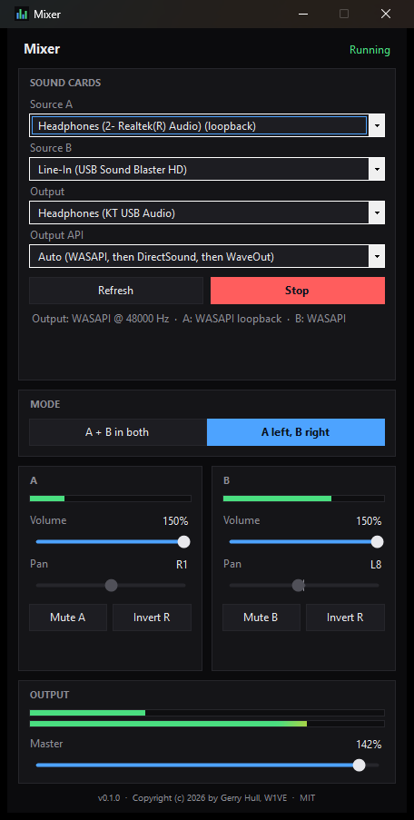

<div align="center">

# 🎚️ Mixer

**Mix two Windows sound cards into a third, live, from one small exe.**

[](https://github.com/w1ve/mixer/releases/latest)
[](#-requirements)
[](#-download)
[](https://dotnet.microsoft.com/)
[](https://github.com/naudio/NAudio)
[](LICENSE)



</div>

---

## 🧩 The problem

You have **three sound cards** in one PC. Two of them carry audio you care about, for example a radio, a rig interface, a game, a SDR, a second app. You want to hear **both at once on the third card**, with control over the mix:

- 🔊 **A + B in both ears**, each with its own volume and a **pan slider** to move it left or right
- 🎧 **A in the left ear, B in the right**, so you can listen to two things at the same time and tell them apart
- 🔇 **Mute A** or **Mute B** with one click

Windows can't do this on its own. "Listen to this device" only works for inputs, gives you no mix or pan control, and can't combine two sources into a split left/right feed.

And there's a second, nastier problem: **a lot of the audio you want is on an output.** A USB headset, a "speakers" device, a virtual cable, a card that only plays. Windows treats those as places sound *goes*, not places it *comes from*, so most mixing tools can't select them at all.

## ✨ What Mixer does

| | |
|---|---|
| 🔁 **Outputs as inputs** | Any playback device can be a source. Mixer captures *what is playing on it* using WASAPI loopback. Real inputs (line-in, mic) work too. |
| 🎛️ **Two mix modes** | **A + B in both** with per-source volume and pan, or **A left, B right** with each source folded to mono on its own side. |
| 🔇 **Mute, volume, master** | Volume 0–150% per source, master 0–150%, one-click mute for each source. |
| 🔄 **Invert R** | Flips a source's right-channel polarity. Fixes miswired stereo lines that cancel out when folded to mono. Mixer **detects this automatically** and shows a warning. |
| 📈 **Live meters** | Peak meters for A, B, and the left and right output. |
| 🎵 **Any Windows sound format** | 16-bit, 24-bit and 32-bit PCM or 32-bit float, mono, stereo or multichannel, at any sample rate. Every source is converted and resampled to the output card's rate. |
| 🛟 **Three output APIs** | **Auto** tries WASAPI, then DirectSound, then WaveOut (MME), and only reports *Running* when the card is really taking audio. You can also force one. |
| 💾 **Remembers everything** | Devices, mode, levels, pan, mute and invert are saved in `Mixer.json` next to the exe and restored at launch. If the setup is complete, it starts on its own. |
| 🩺 **Built-in diagnostics** | `Mixer.exe --probe report.txt` tests every device with every API and writes a report. |
| 🖤 **Black theme** | Dark window and title bar, full keyboard control of every slider, screen-reader labels. |

## 📦 Download

Grab **`Mixer.exe`** from the [latest release](https://github.com/w1ve/mixer/releases/latest) and run it. That's the whole install.

> 🪶 **No dependencies. One file.** The .NET runtime and NAudio are compiled into the exe. You don't need .NET, the Visual C++ redistributable, an installer, or a driver. Copy it to a USB stick and run it on any Windows 10/11 x64 PC. The exe is about 47 MB because the runtime is inside it.

To keep your settings with the app, put `Mixer.exe` in its own folder. It writes `Mixer.json` beside itself. If that folder is read-only (for example, Program Files), it saves to `%APPDATA%\Mixer\config.json` instead.

## 🚀 Quick start

1. **Source A** and **Source B**: pick a device for each. Entries ending in **(loopback)** are outputs captured as inputs. Use **(none)** for an empty slot.
2. **Output**: pick the card you listen on.
3. **Output API**: leave it on **Auto**.
4. Press **Start**.
5. Choose **A + B in both** or **A left, B right**, then set volume, pan and mute.

💡 Tips:
- Double-click a slider to reset it. Sliders take arrow keys (±1), Page Up/Down (±10), Home/End, and the mouse wheel.
- A loopback source can't be the same card as the output. That would feed back, so Mixer refuses it.

## 🔬 How it works

```
 Source A ──► capture (WASAPI / loopback / WaveIn) ──► ring buffer ─┐
                                                                    ├─► mixer ──► output card
 Source B ──► capture (WASAPI / loopback / WaveIn) ──► ring buffer ─┘   (vol, pan,   (WASAPI ▸ DirectSound ▸ WaveOut)
                                                                         mute, mode)
```

**🔁 Outputs as inputs.** WASAPI has a *loopback* mode: you open a capture stream on a render device and receive exactly what Windows is mixing for it. Mixer lists every active output twice, once as an output and once as a "(loopback)" source.

**🎵 Any format in.** Each capture runs in the device's own shared-mode format. Mixer reads 16-, 24- and 32-bit integer or 32-bit float samples, takes the first two channels (mono is copied to both sides), and converts everything to 32-bit float stereo.

**⏱️ Three cards, three clocks.** Every sound card has its own crystal, so "48 kHz" on one card is never exactly 48 kHz on another. Left alone, a buffer slowly overflows (delay builds up) or runs dry (clicks). Each source has a ring buffer with a target fill of about **80 ms**. On every output block, Mixer nudges that source's playback rate by up to ±1% to hold the target, and resamples with linear interpolation. Underruns go silent and re-prime instead of glitching, and large bursts are trimmed. The result is steady, drift-free audio with about 80 ms of delay.

**🎛️ The mix.** The output device pulls audio from Mixer's sample provider. For each frame:
- **A + B in both:** each source is scaled by its volume and *panned as stereo*. Moving left folds the right channel into the left rather than throwing it away, so nothing is lost. A and B are then summed.
- **A left, B right:** each source is folded to mono, `(L + R) / 2`, and sent to its own side.
- Master volume is applied and the result is clipped to ±1.0.

UI changes are lock-free volatile fields that the audio thread reads every block, so moving a slider never blocks or glitches audio.

**🛟 Getting an output to actually play.** Some cards accept a stream and then never ask for audio, and some fail on one API but work on another. On Auto, Mixer tries **WASAPI**, then **DirectSound**, then **WaveOut (MME)**. It only counts a device as started once it has really pulled audio, within 1.5 seconds. If all three fail, you get every API's error with the Windows HRESULT decoded (for example `AUDCLNT_E_DEVICE_INVALIDATED [0x88890004]`) instead of a vague message.

**🧵 Threading.** All Core Audio COM objects live on one dedicated MTA worker thread. The WinForms UI thread only sends commands and reads meters, so COM objects never cross apartments.

## 🛠️ How we built it (the real story)

This started as a **Rust + Tauri** app using `cpal`. It built (cross-compiled on Linux with `cargo-xwin`, because the local MSVC install was missing its libraries), but on this PC it failed with *"The requested device is no longer available"*, even though Windows showed the card as Ready.

So we rewrote it in **C# with NAudio**. NAudio can fall back to DirectSound and WaveOut when WASAPI refuses a card, which `cpal` can't. Then we added `--probe` to stop guessing. It opens every device with every API and records what happens. Two real-world problems turned up, and both now shape the app:

1. **🔌 The USB hub was the culprit.** The probe showed one USB card failing on *all four* APIs, while every other device passed. Both USB sound cards were plugged into the same USB 3 hub. They're full-speed (USB 1.1) devices, so they ran through the hub's internal USB 2.0 hub and its single *transaction translator*, which gives all slow devices one shared bandwidth budget. Windows reserves bandwidth per audio stream, the first card took it, and the second couldn't open. **Moving one card to a port on the PC fixed it instantly**, and every API passed. Mixer now spells out every failed API, so a problem like this is easy to spot.
2. **🔄 The "quiet B" mystery.** In *A left, B right* mode, source B nearly vanished, but it sounded fine in *A + B in both*. We measured the line-in directly: its left and right channels had a correlation of **−1.00**, meaning one was wired inverted. As stereo it sounds normal, but folded to mono `(L + R) / 2` cancels to near silence (about −68 dB). We added **Invert R** per source and an automatic **out-of-phase warning**. With Invert R on, the right output came back at full level (about −31 dB).

Lesson learned: when audio "doesn't work," measure the signal and the hardware before rewriting the code. The diagnostics in Mixer exist because of that.

## 🩺 Troubleshooting

| Symptom | Likely cause and fix |
|---|---|
| Output fails on WASAPI, DirectSound **and** WaveOut | It's the hardware or the USB path, not Mixer. Don't put two USB 1.1 audio devices on the same hub. Plug one into the PC directly, or use a **Multi-TT** hub. Then press **Refresh**. |
| *"Device not found"* | Windows renumbered the card (for example, "2- USB Audio") after a replug. Press **Refresh** and pick it again. |
| One source almost silent in **A left, B right** | Its L/R are out of phase. Watch for the yellow warning and click **Invert R**. |
| Only one side audible on the output | The cable, the jack, or the device you're feeding is mono. Test with ordinary stereo headphones in the card's jack. |
| Loopback source shows no level | Loopback only carries what is *playing* on that output. Start the audio there. |
| Anything else | Run `Mixer.exe --probe report.txt` and check the report. |

## 🧱 Building from source

You need the [.NET 10 SDK](https://dotnet.microsoft.com/download) on Windows.

```powershell
git clone https://github.com/w1ve/mixer.git
cd mixer\MixerNet
dotnet publish -c Release -o ..\dist
# → ..\dist\Mixer.exe  (self-contained, single file, win-x64)
```

| Path | What's in it |
|---|---|
| `MixerNet/Audio/MixEngine.cs` | Device listing, start/stop, output API fallback, error decoding |
| `MixerNet/Audio/SourceChannel.cs` | Capture, format conversion, ring buffer, drift-corrected resampling |
| `MixerNet/Audio/MixProvider.cs` | The mix: volume, pan, mode, mute, invert, meters |
| `MixerNet/Audio/MtaWorker.cs` | Dedicated MTA thread for all Core Audio objects |
| `MixerNet/MainForm.cs`, `MixerNet/UI/` | Black-theme WinForms UI and custom controls |
| `MixerNet/AppConfig.cs` | `Mixer.json` settings |
| `MixerNet/Probe.cs` | The `--probe` diagnostic |

## 📜 License

**MIT.** See [LICENSE](LICENSE).

Copyright © 2026 by **Gerry Hull, W1VE**.

Built with [NAudio](https://github.com/naudio/NAudio) (MIT) and [.NET](https://github.com/dotnet/runtime) (MIT).

<div align="center"><sub>73 de W1VE 📻</sub></div>
